# DM Screen

> An Obsidian plugin that turns your notes into a live player screen and a true-scale battle map for in-person D&D 5e.

DM Screen is for a Dungeon Master (DM) who runs Dungeons & Dragons 5e at a real table, with a TV, tablet or second monitor in the room. Obsidian stays your private screen. The plugin serves a player screen and a battle map to any browser on your local network (LAN), and the players see only what you push.

Status: actively developed. Desktop only (Windows, macOS, Linux). MIT licensed. Installed through BRAT or by hand; it is not in the Obsidian community plugin gallery yet.

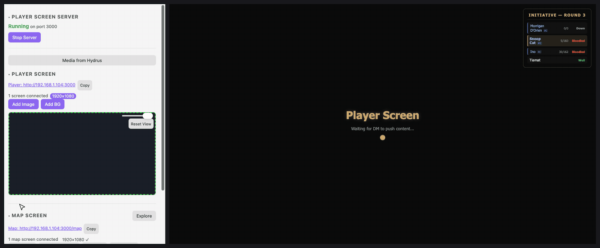

*Left: the DM Control Panel inside Obsidian. Right: the player screen on the TV. Images are added hidden and revealed with the eye toggle when the party should see them.*

## Contents

- [Why DM Screen](#why-dm-screen)
- [Requirements](#requirements)
- [Installation](#installation)
- [Quickstart](#quickstart)
- [Running a session](#running-a-session)
- [Integrations](#integrations)
- [Reference](#reference)
- [Troubleshooting and FAQ](#troubleshooting-and-faq)
- [Network usage and privacy](#network-usage-and-privacy)
- [Contributing](#contributing)
- [Credits and attribution](#credits-and-attribution)
- [License](#license)

## Why DM Screen

At an in-person table you want the players to see the scene art, a handout or the turn order, but not your notes. DM Screen keeps your notes in Obsidian and sends a clean visual layer to the screens in the room.

It is neither a virtual tabletop (VTT) nor a replacement for D&D Beyond or the Initiative Tracker plugin: players do not log in or interact, and the TV only shows the state of the tools you already use. Everything runs on your own network.

What it does:

- [Player screen on any device](#connect-the-screens): a TV, tablet, phone or second monitor opens a link in its browser and follows what you push. It reconnects by itself after a network hiccup.
- [Image layers with per-layer fog of war](#player-screen): stack scene art and portraits, and hide parts of each one under fog of war (a dark mask over what the party has not discovered yet) until they get there.
- [Background image or video](#player-screen): a full-screen scene or a looping video behind the layers.
- [Initiative tracker on the TV](#combat): manual, synced from the Initiative Tracker plugin, or live from a D&D Beyond encounter. The turn order can stay hidden until each combatant acts.
- [Statblocks in the panel](#combat): read a monster's statblock from Fantasy Statblocks without leaving the combat view.
- [Battle map at 1 inch per square](#map-screen-table-tv): a second page, `/map`, shows one map on a table TV at true scale for miniatures, after a one-time calibration.
- [Map fog, walls and dynamic vision](#fog-walls-and-vision): fog you paint once and keep, walls and doors that block line of sight, and torches or darkvision that light only what they reach. Walls can be imported from Universal VTT (UVTT) files and Foundry VTT modules.
- [Spell area-of-effect (AoE) templates](#spell-aoe-overlays): circles, cones, lines and more at grid scale, or pick a spell from the 5e list.
- [Exploration Mode](#exploration-mode): a full-window view for play. Click doors and rooms, move what the table sees, and run combat from floating windows.
- [Hydrus Network library](#hydrus-network): search a self-hosted image library by tag and push any file to either screen.
- [Send a layer to Telegram or Discord](#webhooks-telegram-discord-any-multipart-endpoint): share a handout with players who are not at the table.

## Requirements

- Obsidian desktop (Windows, macOS, Linux). The plugin is not available on mobile.
- The computer running Obsidian and every screen on the same network, one you trust.
- A browser on each screen: a smart TV browser, Fully Kiosk Browser on Android or Google TV, a tablet, a phone, or a second monitor.
- A firewall that lets the other devices reach the server port (see [Network usage and privacy](#network-usage-and-privacy)).

Optional:

- [Hydrus Network](https://hydrusnetwork.github.io/hydrus/), self-hosted, for a tagged image and video library.
- A [D&D Beyond](https://www.dndbeyond.com) account, for live encounter sync.
- The [Initiative Tracker](https://github.com/javalent/initiative-tracker) and [Fantasy Statblocks](https://github.com/javalent/fantasy-statblocks) plugins.
- A Telegram bot or a Discord webhook, to send images out.

## Installation

DM Screen is not yet listed in the Obsidian community plugin gallery. Install it with BRAT or by hand.

### With BRAT (recommended)

[BRAT](https://github.com/TfTHacker/obsidian42-brat) installs plugins straight from GitHub.

1. Install BRAT from **Settings → Community plugins → Browse** and enable it.
2. Run the BRAT command **Add a beta plugin for testing** and enter `hbermu/obsidian-dm-screens`.
3. Enable **DM Screen** in **Settings → Community plugins**.

BRAT installs the latest release when it checks for updates: at startup, if that is turned on in BRAT's settings, or when you run its update command.

### Manual

1. Download `main.js`, `manifest.json` and `styles.css` from the [latest release](https://github.com/hbermu/obsidian-dm-screens/releases/latest).
2. Put them in `<your vault>/.obsidian/plugins/dm-screen/`.
3. Reload Obsidian and enable **DM Screen** in **Settings → Community plugins**.

## Quickstart

This gets one picture and an initiative tracker onto a second screen.

1. Open the DM Control Panel: click the monitor icon in the ribbon ("DM Screen"), or run **Open DM Control Panel** from the Command Palette.
2. Click **Start Server**. The panel shows **Running on port 3000**.
3. In the **Player Screen** section, click **Copy** next to the player link and open the link on the TV or tablet. Use Copy rather than typing the address: the copied link carries the access token. The screen shows "Player Screen" and "Waiting for DM to push content...", and the panel shows **1 screen connected** with the screen's resolution.
4. Open a note that embeds an image, such as `![[tavern.png]]`. Click **Add Image**. The image arrives as a hidden layer; click its 👁 to show it.
5. Click **Add BG** to use the same image as the full-screen background.
6. In **COMBAT**, on the **Local Track** tab, add two combatants (name, initiative, HP, then `+`) and click **Next Turn**.

The TV now shows the background, the image and the initiative tracker. [Running a session](#running-a-session) covers the rest.

## Running a session

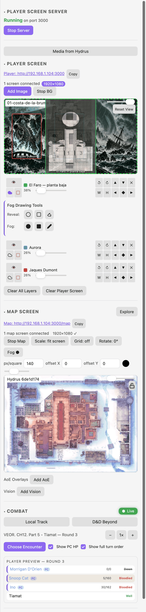

The DM Control Panel has four collapsible sections: **Player Screen Server**, **Player Screen**, **Map Screen** and **COMBAT**. When Hydrus is enabled and has an API URL, a **Media from Hydrus** bar sits between them. Click a section title to fold it.

### Before the session

**Prepare your notes.** Add Image, Add BG and Add Map list the images in the active note:

- the `image:` and `portrait:` frontmatter keys, written as wikilinks;
- `![[...]]` embeds of png, jpg, jpeg, webp and gif files;
- `hydrus://` references (see below).

If the note has one usable image, the button applies it at once. With several, a picker opens.

**Link Hydrus files from a note.** In the Hydrus explorer, **Copy image reference** copies a Markdown link like `[Tavern night](hydrus://<hash>)`. Paste it into a note. The pickers list it as "Hydrus: Tavern night". If Hydrus is offline, the plugin uses its local copy; references with no local copy show as "(offline, not cached)" and cannot be picked. Video references are offered only for Add BG and Add Map.

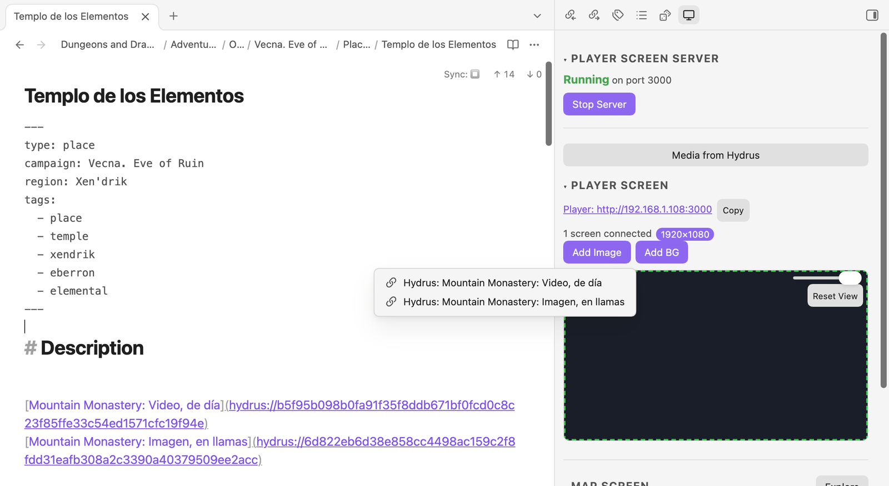

**Connect the screens.** With the server running, the panel shows a player link (`/`) and a map link (`/map`), each with a **Copy** button. Open them on the screens. A device keeps the access token in a cookie for a day, so reloading the page works. **Regenerate** in settings mints a new token and disconnects every screen.

**Prepare offline.** You can set backgrounds and maps, paint fog and draw walls with the server stopped. The current state is sent when the server starts.

### Player screen

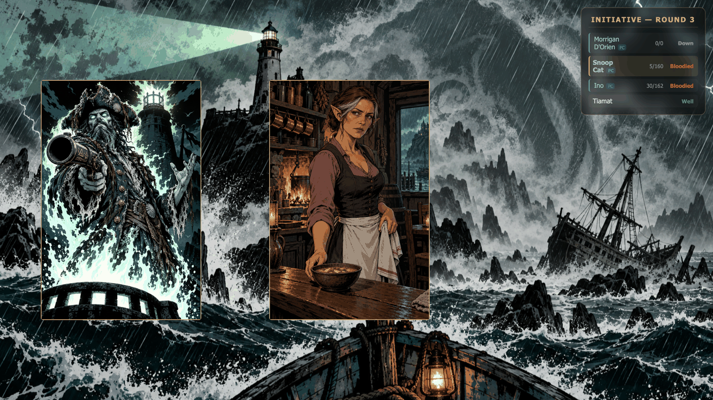

**Image layers.** **Add Image** adds the note's image as a hidden layer. Each layer row has:

- 👁 to show or hide it, a fog button, and a border toggle;
- a scale slider from 10 % to 500 % (Shift + ← / → snaps to the next multiple of 10);
- rotate in 15° steps, ▲ ▼ to change the stacking order, and ✕ to remove;
- **W** and **H** to fit the layer to the player's view width or height, and ◀ ◆ ▶ to align it left, centre or right. These need a connected screen.

Drag a layer on the preview to move it. Two layers cannot share a label. **Clear All Layers** removes the layers; **Clear Player Screen** clears everything the players see. Right-click a layer row to [send it to a webhook](#webhooks-telegram-discord-any-multipart-endpoint).

**Per-layer fog.** Click a layer's fog button. The **Reveal** row has circle, rectangle and eraser tools; the **Fog** row has circle, rectangle and freehand pen. Hold Shift when you release the mouse to keep drawing; press Escape to stop.

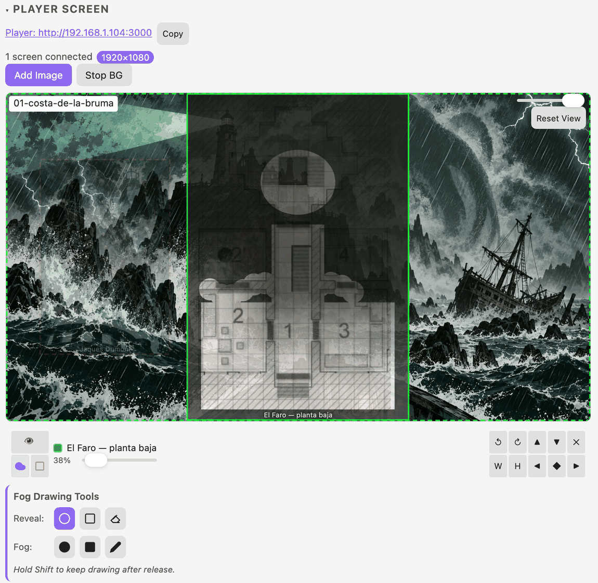

*Per-layer fog on the DM preview. The zoom slider, Reset View and the green rectangle for the player's viewport are visible too. The map screen has its own fog system, described in [Fog, walls and vision](#fog-walls-and-vision).*

**Background.** **Add BG** sets an image or video as the full-screen background, and **Stop BG** removes it. Videos loop and play muted by default (see the [Hydrus Library settings](#settings)). The Hydrus explorer has a **Set as background** action too.

**DM preview.** The preview in the panel shows what the players see, scaled down. Middle-drag to pan, use the slider to zoom out and see around the player's view, and click **Reset View** to go back. With one screen connected, a green rectangle marks that screen's viewport. Your pan and zoom stay on your side and are never sent to the players.

**Several screens.** Each connected screen appears as a resolution badge. Screens with the same resolution share one badge, for example `1920×1080 ×2`. Click a badge to size the preview for that screen. Every screen gets the same picture. With more than one screen connected, the viewport rectangle is hidden.

### Combat

The **COMBAT** section has two tabs: **Local Track** (manual or Initiative Tracker) and **D&D Beyond** (shown once the integration is enabled and has a cookie). The **● Live** indicator shows that a tracker is on the player screen; click it to stop broadcasting. The `−` / `1×` / `+` buttons resize the tracker on the TV.

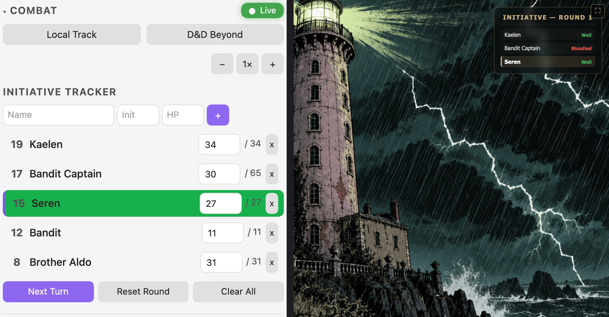

**Manual tracker.** Enter name, initiative and HP, then click `+`. HP is editable in the row. Use **Next Turn**, **Reset Round** and **Clear All**. Click a name to set conditions and exhaustion. The manual tracker lives for the session only and is not saved.

**Initiative Tracker plugin.** Start an encounter in Initiative Tracker and the tab switches to a **Synced** view: round, encounter name, HP bars, AC and a **Disconnect** button. Sync is one way, so make changes in Initiative Tracker.

**D&D Beyond.** Click **Choose Encounter** and pick one of your encounters. **Show PC HP** adds the player characters' HP to the TV. Right-click a monster for **Rename…** or **Conditions…**; these change only what you see and show, not D&D Beyond. Characters with Heroic Inspiration glow gold. Monster portraits are added as hidden, portrait-sized image layers; reveal them with 👁. Nothing is written back to D&D Beyond, so run the encounter there.

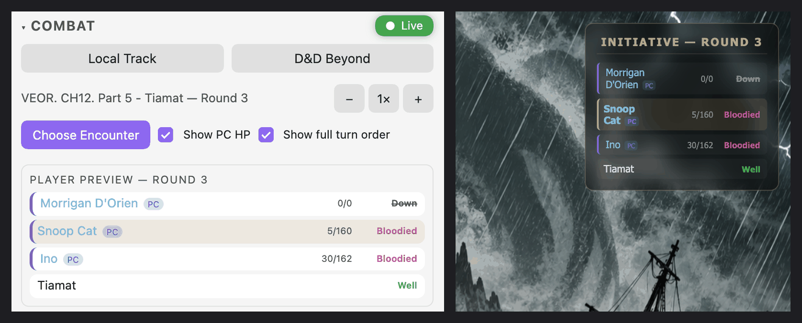

**What players see.** With the manual tracker and Initiative Tracker, the TV lists only the combatants up to the one acting in round 1, so the order is revealed as turns pass; from round 2 on, it lists everyone. With D&D Beyond, the TV hides the combatants after the one acting in every round until you turn on **Show full turn order**. It turns on by itself when you join an encounter already past round 1. Hidden combatants never reach the TV. Monsters show a condition word (Well, Hurt, Bloodied, Down) instead of their HP.

**Statblocks.** With Fantasy Statblocks installed, expand a combatant synced from Initiative Tracker to read its statblock in the panel. A numbered name like "Goblin 3" falls back to "Goblin". Statblocks are never shown to players. Manual and D&D Beyond rows have no statblock.

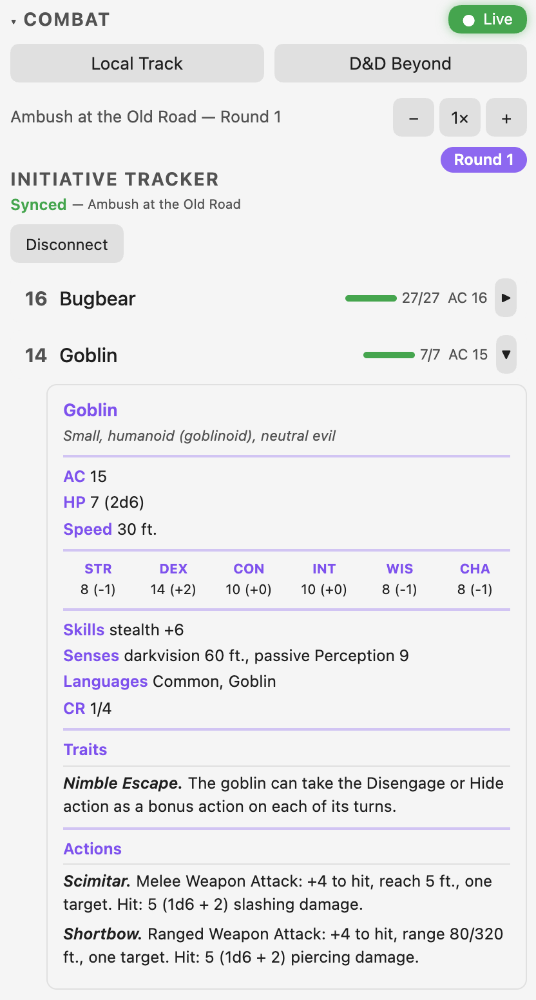

### Map screen (table TV)

The `/map` page shows one battle map on a TV laid flat on the table, for playing with miniatures. It is independent of the player screen: clearing one never touches the other, and both can run at once.

**Setup**

1. Open the map link from the **Map Screen** section (use **Copy**) on the table TV, then go fullscreen with the on-screen button.
2. The TV appears as a resolution badge in the panel. Click it and enter the screen's **diagonal in inches**. Turn on **Show test pattern** (a 6-inch ruler and a 1-inch square on the TV) and use **Fine-tune** until a real ruler agrees. Calibration is stored per resolution; a calibrated badge shows `✓`.

   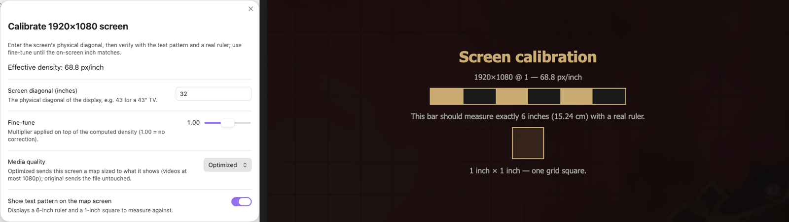
3. Click **Add Map**. It offers the same sources as Add BG, including `hydrus://` videos for animated maps. The Hydrus explorer also has **Set as map**.

**At the table**

- **Scale**: *fit screen* shows the whole map; *physical 1″* draws every grid square as one real inch, so miniatures sit at true scale.
- **Pan**: in physical mode, drag the green rectangle on the panel's preview, or click in the preview, to choose what the TV shows. The wheel zooms your preview only, middle-drag looks around, and the 🔒 lock stops you moving the players' view by accident.
- **Rotate**: 90° steps. In fit mode, a portrait map turned sideways uses the whole landscape TV.
- **Grid overlay**: a grid drawn over gridless maps. `px/square` is how many map pixels one square spans (the default is a setting), `offset X/Y` shifts the grid when it does not start at the image corner, and colour and opacity are adjustable.

Scale mode, pan, rotation and grid are remembered per map and restored when you show the same map again.

If the TV is not calibrated, physical mode assumes 96 px per inch and both the TV and the panel show a warning.

**Media sized to each screen.** By default each map screen gets images as a downscaled WebP, and videos larger than 1080p re-encoded to fit 1920×1080, because most TV decoders refuse anything bigger. Encoding uses the computer's hardware video encoder; without one, the original is sent. To send a screen the originals, set **Media quality** to *Original* in its calibration window; its badge then shows `· original`.

**A start page for the table TV.** On an Android or Google TV with Fully Kiosk Browser, [`tv-kiosk/`](tv-kiosk/README.md) installs a start page over Android Debug Bridge (ADB). It lists the computers that may run the server, opens the first one that answers after a short countdown, and lets you pick another (or type a one-off server) with the remote.

### Fog, walls and vision

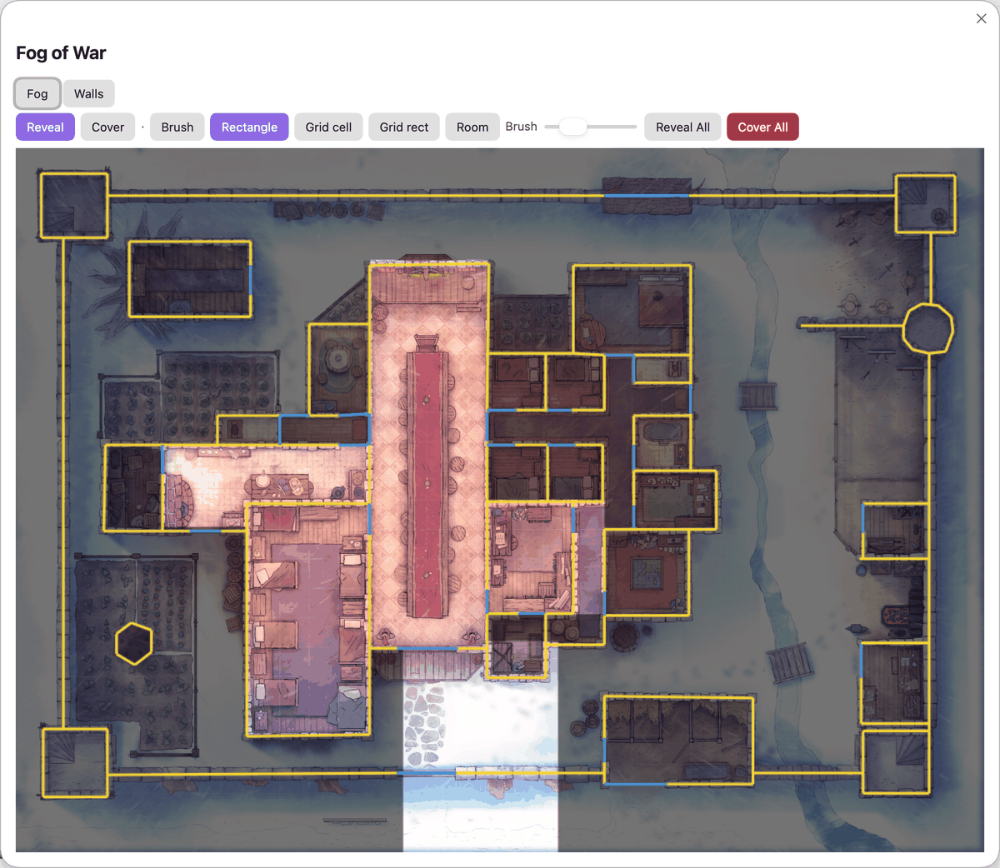

*The Fog editor: reveal or cover with brush, rectangle, grid-cell and whole-room tools, plus a Walls tab for line of sight.*

While a map is showing, the Map Screen section has a **Fog** button (it reads `Fog ●` once the map has fog). It opens an editor with two tabs.

**Fog tab.** One mask over the map: black hides, transparent reveals. Pick **Reveal** or **Cover**, then paint with a **Brush** (size slider), a **Rectangle**, a snapped **Grid cell** or **Grid rect**, or the **Room** tool, which fills a whole walled room in one click. **Reveal All** and **Cover All** reset the map. The fog is saved per map ([where](#urls-ports-and-files)) and comes back whenever you show that map again. How dark it looks on the TV is a setting.

**Walls tab.** Draw line-of-sight **Walls** and **Doors** with chained clicks (right-click ends the chain) or a **Rect** drag. **Toggle door** opens and closes a door, **Erase** removes segments, and **Snap** aligns to the grid. Walls are saved per map too, and drive dynamic vision and the Room tool.

**Import walls.** You do not have to draw walls by hand. On the Walls tab:

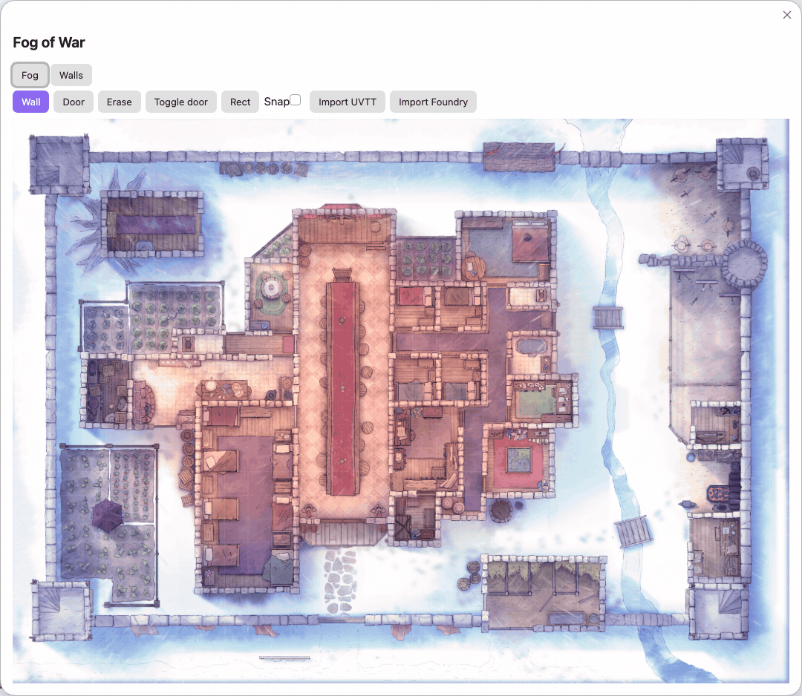

- **Import UVTT** loads a `.dd2vtt`, `.uvtt`, `.df2vtt` or `.json` export (Dungeondraft and most VTT map packs). Walls, objects and portals become walls and doors, and the map's grid size is set for you.
- **Import Foundry** loads a Foundry VTT module `.zip` (old NeDB or new LevelDB layout), the format Czepeku and other creators ship. Walls and doors are scaled to your map. With several scenes, the one matching your map's shape is picked, and a picker asks when more than one fits.
- **From Hydrus**: when you set a Hydrus image as the map and your library has a Foundry module zip tagged `type:foundry module` with the same `name:` tag, the plugin asks "Import its walls and grid?". It reads only the few MB of scene data from the zip, not the artwork around it.

**Dynamic vision.** Click **Add Vision** and pick **Circle 30 ft**, **Square 30 ft** or **Lights…**. Drag it onto a token and the fog opens for what it can see. Each vision has a **bright** radius and an optional **dim** ring that stays half-shrouded. **Lights…** fills both from the 5e list (torch 20 ft plus 20 ft dim, lanterns, *light*, *daylight*, darkvision 60 or 120 ft, and more). Name and colour visions to tell them apart; the 🔗 group toggle drags them all together. Walls stop the light; an open door lets it through and a closed one blocks it. **Bake into fog** burns the current vision into the fog for good (for areas already explored) and clears the live layer. **Clear All** removes every vision.

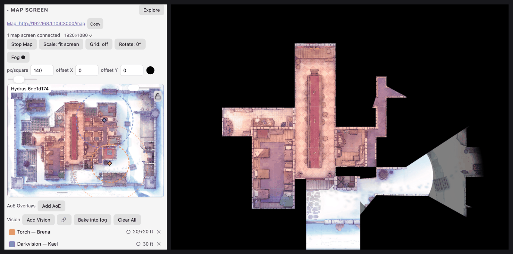

*A torch (bright and dim ring) and a darkvision on the panel's preview. On the TV, walls cut the line of sight and only what the lights reach is revealed.*

### Spell AoE overlays

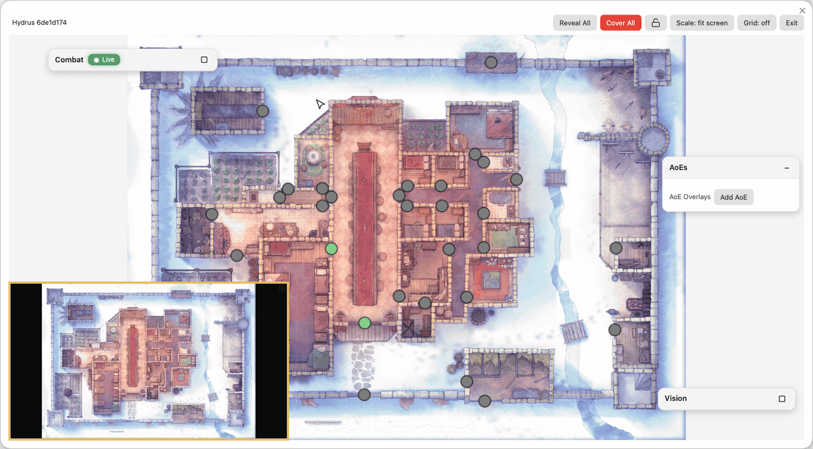

*Templates render at grid scale (1 square = 5 ft) on both the DM's view and the TV (bottom-left inset). Shown here from Exploration Mode's AoEs window; the panel section works the same way.*

The **AoE Overlays** section places spell templates on the map. Click **Add AoE** and pick **Circle**, **Square**, **Cone**, **Line** or **Ring**, or **Spells…** to search the 5e spell list and fill in the shape, size and colour. Each template has its own size (and width, for lines and rings), colour, opacity and rotation. Drag the dot on the preview to place it and the diamond to aim it. Templates are combat state: they clear when you stop the map.

### Exploration Mode

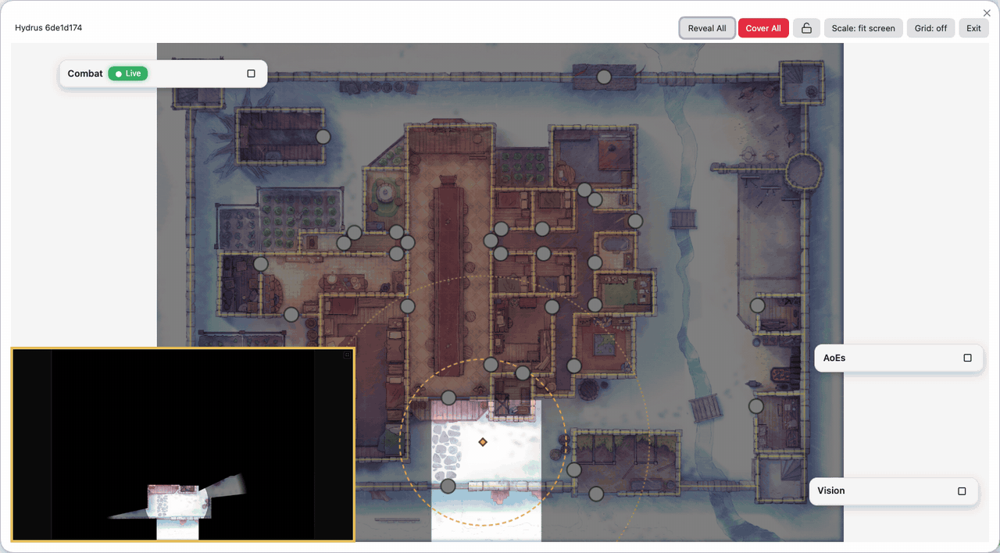

*Opening the hall door lets the torchlight in, a click reveals each room, and in physical scale the green rectangle is what the table TV (bottom-left inset) shows.*

The **Explore** button next to the Map Screen title opens a near-fullscreen view for running the game. It works with the section collapsed and is disabled until a map is showing.

- Click a door to open or close it (green is open, grey is closed). The TV recomputes line of sight at once.
- Click a room to reveal or cover its fog. A green highlight shows which room you are about to change. Doors always bound a room here, so opening a door does not merge two rooms.
- In physical mode, drag the viewport rectangle to move what the table sees. The 🔒 lock freezes it. Hold Shift to click through to doors and rooms without moving anything.
- Turn on ⦿ on a vision to bind it to the players' view. Pan the view and the light moves with it, keeping its offset, like a torch carried through the dungeon.
- The top bar has **Reveal All**, **Cover All**, the lock, **Scale**, **Grid** and **Exit**.
- Floating **AoEs**, **Vision** and **Combat** windows carry the full controls, so you can place templates or run initiative (local, Initiative Tracker or D&D Beyond) without leaving. Drag them by the header or minimise them; they remember where you left them.

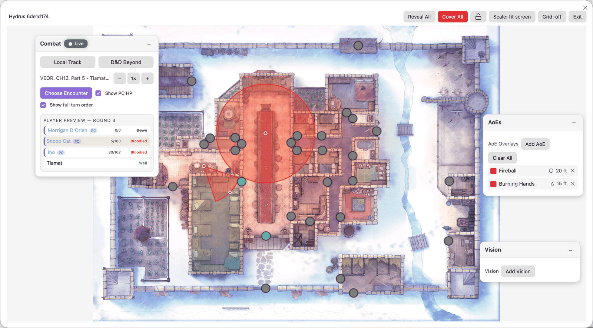

Exploration Mode uses the same fog, walls and visions as the editor. The editor is for preparing them; Exploration Mode is for using them at the table.

## Integrations

### Hydrus Network

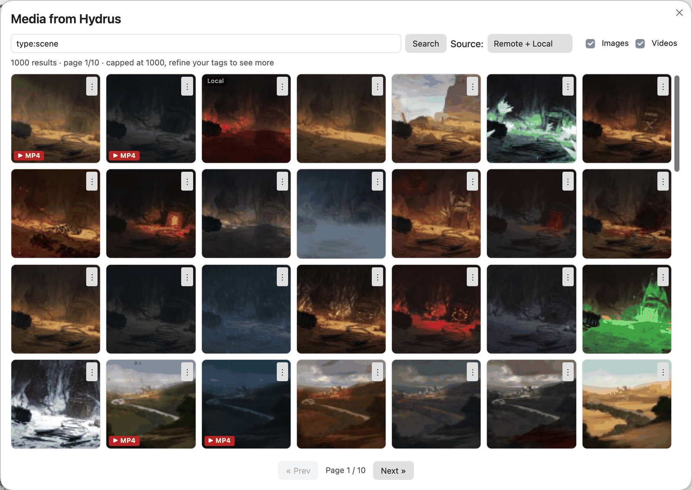

[Hydrus Network](https://hydrusnetwork.github.io/hydrus/) is a self-hosted media manager that organises files by tags. If you keep many maps and scene images, it lets you find "tavern, night" in seconds and push the result to a screen.

Setup, in **Settings → DM Screen → Hydrus Library**:

1. Turn on **Enable Hydrus integration**.
2. Enter the **API URL** of your Hydrus Client API (for example `http://localhost:45869`) and the **API key**, then click **Test connection**.
3. Click **Fetch services** and tick the tag services to search.

Click **Media from Hydrus** in the panel to open the explorer. Search by tags (with autocomplete), choose the source (remote plus local cache, or local only), and filter by images or videos. Left-click a tile for a full-size preview with actions; right-click it, or use ⋮, for the same actions as a menu: add as image layer, set as background, set as map, copy tags, copy image reference, and download or delete the local copy. Videos can be a background or a map, not an image layer.

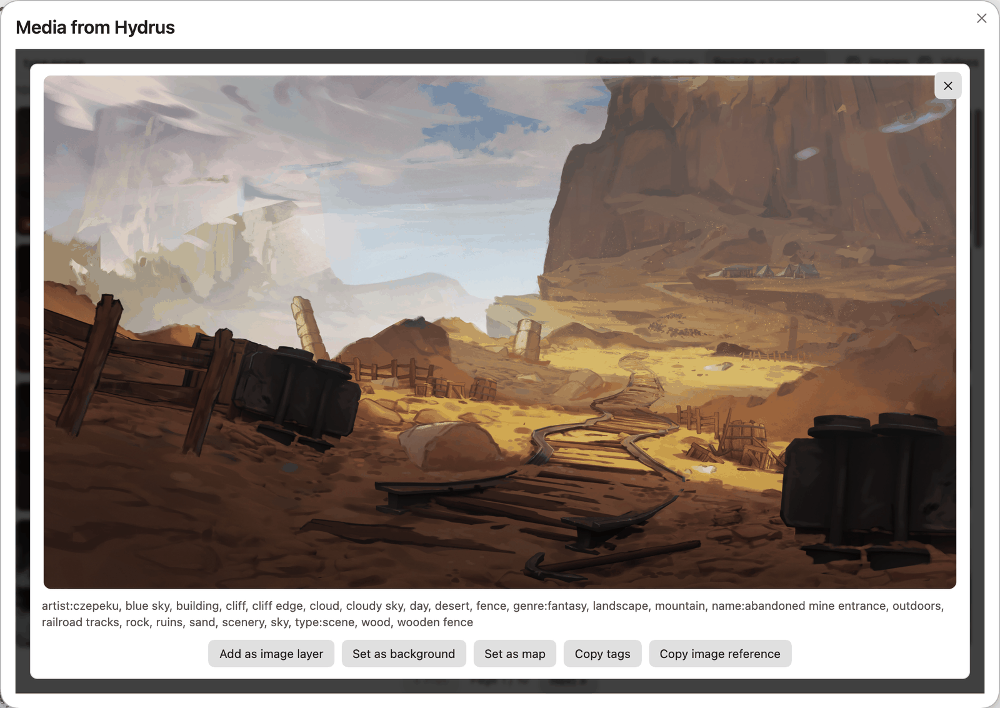

Downloaded files are cached in `<cache folder>/hydrus/` inside the vault and removed after the number of days set in **Cache TTL**.

No Hydrus yet? [hydrus/README.md](hydrus/README.md) runs it with Docker Compose, API key included, and has a script that tags your maps from their folder layout (including the tags the Foundry wall import looks for).

### D&D Beyond

The plugin reads a live encounter from your [D&D Beyond](https://www.dndbeyond.com) account. It only reads: you run the encounter in D&D Beyond and the TV follows.

1. In **Settings → DM Screen → D&D Beyond**, turn on **Enable D&D Beyond integration**.
2. Click **Open D&D Beyond** and log in.
3. In your browser's developer tools (Application → Cookies → dndbeyond.com), copy the `CobaltSession` cookie.
4. Paste it into **CobaltSession cookie** and click **Test connection**.

The cookie is your login session. It is stored in the plugin's settings file in plain text, so treat your vault folder accordingly. [Combat](#combat) covers how to use the D&D Beyond tab.

### Initiative Tracker and Fantasy Statblocks

When these community plugins are installed and enabled, DM Screen uses them:

- [Initiative Tracker](https://github.com/javalent/initiative-tracker): its encounter (combatants, HP, statuses, round) feeds COMBAT and the TV as soon as you start it.
- [Fantasy Statblocks](https://github.com/javalent/fantasy-statblocks): statblocks in the panel.

[Combat](#combat) covers how both work during play.

### Webhooks (Telegram, Discord, any multipart endpoint)

You can send an image layer to a chat, for a player who is not at the table or to keep a record. Anything that accepts a `multipart/form-data` upload works.

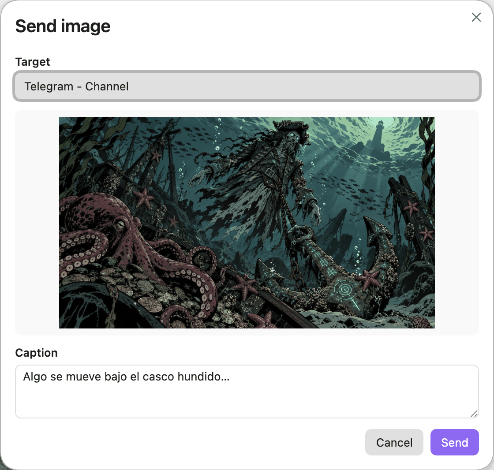

- **[Telegram](https://core.telegram.org/bots/api#sendphoto) bot**: `sendPhoto` to a chat your bot is in, with the caption.
- **[Discord](https://discord.com/developers/docs/resources/webhook#execute-webhook) webhook**: posts the image into a channel; the caption becomes the message.
- **Generic**: anything else. You set the image field name, the caption field name and any extra static form fields.

Setup:

1. Open **Settings → DM Screen → Webhooks**.
2. Click **Load template ▾** and pick **Telegram bot**, **Discord webhook** or **Generic multipart**.
3. Replace the placeholders in the URL (`<TOKEN>`, `<CHAT_ID>`, `<ID>`) with your bot's or channel's values. URL fields show in plain text so you can copy long bot URLs out to an editor.

To send, right-click an image layer, choose **Send to image webhook…**, pick the target, edit the caption (it defaults to the layer's label) and click Send. One layer goes per send, up to 32 MiB. Fog is never drawn onto the sent image: the layer is sent as it is.

## Reference

### Commands

| Command | What it does |
|---|---|
| Open DM Control Panel | Opens the DM Control Panel |
| Toggle Player Screen Server | Starts or stops the server. Stopping also stops every combat broadcast |
| Ribbon icon "DM Screen" (monitor) | Opens the DM Control Panel |

No hotkeys are assigned by default; set them in **Settings → Hotkeys**.

### Settings

**Settings → DM Screen** has six blocks. The first block, under the page title, holds the server settings.

**Server (first block)**

| Setting | What it does | Default |
|---|---|---|
| Server Port | Port of the player and map screen server | `3000` |
| Auto-start Server | Starts the server when Obsidian opens | off |
| Access token | Token every screen must present; the join links carry it. **Regenerate** makes a new one and disconnects every screen | created on first load |
| Max connected clients | Most player and map screens connected at once | `10` |
| Waiting screen title | Large text on the player screen while nothing is shown; empty hides it | `Player Screen` |
| Waiting screen subtitle | Smaller text under the title; empty hides it | `Waiting for DM to push content...` |

**Map Screen**

| Setting | What it does | Default |
|---|---|---|
| Default grid cell size (px/square) | Map pixels per grid square for maps not yet set up (Czepeku full resolution is 140, VTT-sized maps 70). Each map can override it in the panel | `140` |
| Fog opacity on the map screen | How dark fog looks on the table TV, from 0.3 to 1. Lower lets players faintly see the map | `1` |

Calibration (diagonal, fine-tune, media quality) is per screen, in the window that opens from the screen's badge.

**Hydrus Library**

| Setting | What it does | Default |
|---|---|---|
| Enable Hydrus integration | Shows the Media from Hydrus button in the panel | off |
| API URL | Base URL of the Hydrus Client API, no trailing slash | empty |
| API key | Hydrus Client API access key. **Test connection** checks it | empty |
| Tag services | Hydrus tag services to search. **Fetch services** lists them | none |
| Cache base folder | Vault folder for cached files: Hydrus files in `<folder>/hydrus/`, D&D Beyond portraits in `<folder>/beyond/` | `.dm-screen` |
| Cache TTL (days) | Cached files unused this long are removed | `30` |
| Loop background media | Default loop setting for video backgrounds and maps | on |
| Mute background media | Default mute setting for video backgrounds and maps | on |
| Default search tags | Tags filled into the explorer search, comma separated | empty |
| Ignored tag patterns | Regular expressions, one per line, each matched against the whole tag; matching tags are hidden in the tile menu and in Copy tags | `wd eva02-large v3 tagger ai generated tags`, `wd v1\.4 vit v2 tagger ai generated tags`, `rating:.*` |
| Clear Hydrus cache | **Clear cache** deletes everything in the cache folder. It cannot be undone | |

**D&D Beyond**

| Setting | What it does | Default |
|---|---|---|
| Enable D&D Beyond integration | Adds the D&D Beyond tab to COMBAT | off |
| CobaltSession cookie | Your D&D Beyond session cookie | empty |
| Connection | **Open D&D Beyond** to log in, **Test connection** to check the cookie | |
| Pulse on inspired PC rows | Animates the gold glow on characters with Heroic Inspiration; off leaves it still | on |

**Webhooks**

**+ Add webhook** adds a target and **Load template ▾** adds a ready-made one (Telegram bot, Discord webhook, Generic multipart). Each target has:

| Field | What it does |
|---|---|
| Name | Name shown in the Send window's target list |
| URL | Full endpoint URL. It may contain a bot token, so do not share screenshots of it |
| Image field name | Form field for the image (Telegram `photo`, Discord `files[0]`). New targets start with `file` |
| Caption field name | Form field for the caption (Telegram `caption`, Discord `content`). Empty sends no caption |
| Extra form fields | Fixed key and value pairs sent with every request, such as Telegram's `chat_id` |
| Delete webhook | Removes the target |

**Advanced**

| Setting | What it does | Default |
|---|---|---|
| Debug mode | Writes detailed logs to the developer console (Ctrl+Shift+I) | off |

### Mouse and keyboard

| Where | Input | Action |
|---|---|---|
| DM preview | Drag a layer | Move it |
| DM preview | Middle-drag | Pan your preview (players are not affected) |
| DM preview | Zoom slider, Reset View | Zoom out to see around the player's view, or reset |
| DM preview | Mouse wheel | Scrolls the panel; it does not zoom |
| Layer row | Right-click | Webhook menu |
| Layer scale slider | Shift + ← / → | Snap to the previous or next multiple of 10 % |
| Per-layer fog | Hold Shift on release | Keep drawing |
| Per-layer fog | Escape | Stop drawing |
| Section title | Click | Fold or unfold the section |
| Map preview | Drag or click the green rectangle | Move the players' view (physical mode) |
| Map preview | Wheel or slider | Zoom your preview toward the cursor |
| Map preview | Middle-drag, or left-drag while 🔒 is on | Look around without moving the players' view |
| Map preview | Drag an AoE's dot or diamond | Move or aim the template |
| Walls tab | Click, click… then right-click | Chain wall or door segments, then end the chain |
| Exploration Mode | Click a door or a room | Open or close the door, reveal or cover the room |
| Exploration Mode | Hold Shift | Click through markers and the viewport rectangle |
| Exploration Mode | Right-click an AoE dot | Remove the template |
| Hydrus explorer | Left-click a tile; right-click or ⋮ | Preview; action menu |
| Hydrus tag search | ↑ / ↓, Enter, Escape | Pick a suggestion, apply or search, close |
| COMBAT, manual | Click a name | Conditions menu |
| COMBAT, D&D Beyond | Right-click a monster | Rename…, Reset name, Conditions… |
| TV start page | Any key; arrows; OK; Back | Stop the countdown; move; open; close the form |

### URLs, ports and files

| Address | What it serves | Access |
|---|---|---|
| `http://<computer-ip>:<port>/` | Player screen | token |
| `http://<computer-ip>:<port>/map` | Map screen | token |
| `/health` | Server status and client count, used by the TV start page | open |
| `/vault/<path>` | Only the vault files currently on a screen | token |

- The token travels as the `k` parameter in the join link, then as a cookie that lasts one day. The link text in the panel leaves it out.
- The server's port and network exposure are under [Network usage and privacy](#network-usage-and-privacy).
- Files in the vault: `<cache folder>/hydrus/` and `<cache folder>/beyond/` (cache folder `.dm-screen` by default), and the per-map fog and walls in `.dm-screen/fog/` and `.dm-screen/walls/`. Fog and walls are kept when a map stops.
- The TV start page installer uses ADB on port 5555 and, optionally, Fully Kiosk Remote Admin on port 2323, only while you run it.

## Troubleshooting and FAQ

**The TV cannot open the link, or it times out.** Check that the TV and the computer are on the same network. Use the link from the panel's Copy button: it has the computer's network address, not `localhost`. Check that your operating system's firewall allows Obsidian to accept connections on the server port; Windows and macOS usually ask the first time the server starts. If another program uses the port, change **Server Port**.

**The screen shows only the word `Unauthorized`.** The link has no token, or the token was regenerated. Copy the link again from the panel.

**A screen drops with "Max clients reached".** Raise **Max connected clients**.

**A video background or map does not play.** Browsers autoplay only muted video. Keep **Mute background media** on (it is on by default).

**A video map is black or stutters on the TV.** Most TV decoders refuse video above 1080p. Keep **Media quality** on *Optimized* so the computer re-encodes the video to fit 1920×1080. If the computer has no hardware video encoder, the original is sent; convert large videos to 1080p yourself in that case.

**Squares are not one inch, or the TV says "Uncalibrated screen".** Calibration is stored per resolution. Going fullscreen changes the resolution, so calibrate in the mode you play in.

**"Image unavailable", or `Background "…" is no longer available`.** The file was moved or deleted from the vault. Hydrus files are downloaded again when Hydrus is reachable.

**"No images found in note".** The active note has no `image` or `portrait` frontmatter, no `![[...]]` image embed and no `hydrus://` link.

**W or H says "No player connected".** The fit buttons need a connected player screen to measure.

**The D&D Beyond tab is missing, or Test connection fails.** The tab needs both **Enable D&D Beyond integration** and a cookie. The cookie stops working when you log out of D&D Beyond; log in again and paste a fresh one.

**"Statblock not found in bestiary".** The name is not in Fantasy Statblocks' bestiary, or Fantasy Statblocks loaded after the sync started. Reload Obsidian.

**A Hydrus or webhook URL is rejected with "must use https".** Plain `http` is allowed only for `localhost`, private network addresses and `.local` names. Use `https` for anything else.

**"Send failed: Webhook … returned …".** Check the URL placeholders and the field names (Telegram: `photo` and `caption`; Discord: `files[0]` and `content`).

**Something else.** Turn on **Debug mode**, reproduce the problem and open the developer console (Ctrl+Shift+I). [Open an issue](https://github.com/hbermu/obsidian-dm-screens/issues) with the log; the plugin hides tokens in its logs.

## Network usage and privacy

DM Screen starts a web server on your computer and, if you enable them, talks to a few outside services:

- **Local server.** HTTP and WebSocket on all network interfaces, port 3000 by default, so devices in the room can reach it. Every address except `/health` needs the access token, which the join links carry. Another device on the network cannot watch your screens or read vault files without it. The server serves only the vault files currently on a screen. Traffic is plain HTTP: the token controls access but does not encrypt, so use it on a network you trust. [docs/THREAT-MODEL.md](docs/THREAT-MODEL.md) has the details, including why TLS is not included.
- **Hydrus Network** (optional). Connects to the Hydrus Client API at the URL you enter, to search and download files. The API key is kept in the plugin settings, goes only to that address and never reaches player screens.
- **D&D Beyond** (optional). Exchanges your `CobaltSession` cookie for a short-lived token with D&D Beyond's login service, then polls the encounter, character and monster data. Monster portraits are downloaded over https. See [D&D Beyond](#dd-beyond) for how the cookie is stored.
- **Webhooks** (optional). Sends an image only when you click Send.
- **TV start page installer** (optional, [`tv-kiosk/`](tv-kiosk/README.md)). Talks to the TV over ADB and, optionally, Fully Kiosk Remote Admin, only while you run it.

Files: caches and per-map data live inside the vault (`.dm-screen/` by default). Outside the vault, the plugin reads only the files you pick for a UVTT or Foundry import. Video re-encoding runs on your computer.

There is no telemetry, no account and no ads. Nothing is sent anywhere without an action from you.

## Contributing

Bug reports and feature requests go to [GitHub issues](https://github.com/hbermu/obsidian-dm-screens/issues). Pull requests are welcome. Read [AGENTS.md](AGENTS.md) first: everything builds and tests in Docker through `make`, branches are named `<type>/<slug>`, PR titles follow Conventional Commits, and a change in behaviour updates its spec under `.agent/features/`.

## Credits and attribution

The battlemap in the map-screen screenshots and GIFs (*Adventurers' Guildhall*, walls imported from its Foundry module) and the scene art in the Hydrus screenshots are by [Czepeku](https://www.czepeku.com/) ([Patreon](https://www.patreon.com/czepeku)); they are not bundled with DM Screen and all rights stay with Czepeku. The plugin ships no map assets of its own.

The spell AoE and light-source catalogs are generated from [5etools](https://5e.tools/) spell and item data (light sources by `scripts/gen-light-sources.py`).

The plugin bundles [fflate](https://github.com/101arrowz/fflate) (MIT), for reading Foundry module zips, and [Mediabunny](https://github.com/Vanilagy/mediabunny) (MPL-2.0), for re-encoding map videos.

## License

[MIT](LICENSE) © Héctor Bermúdez
